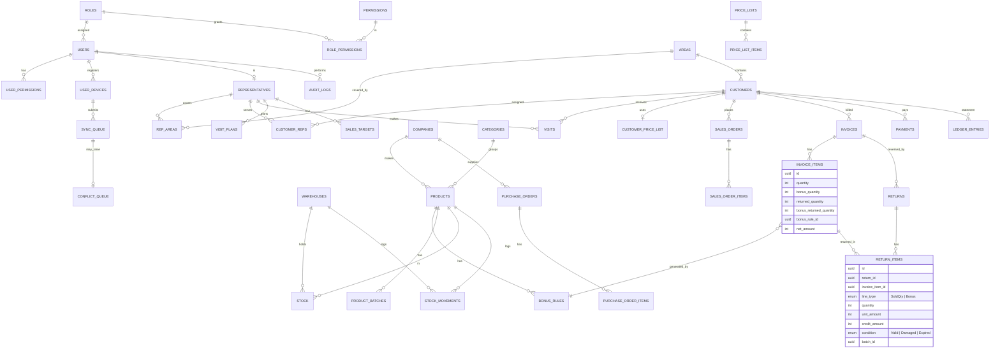
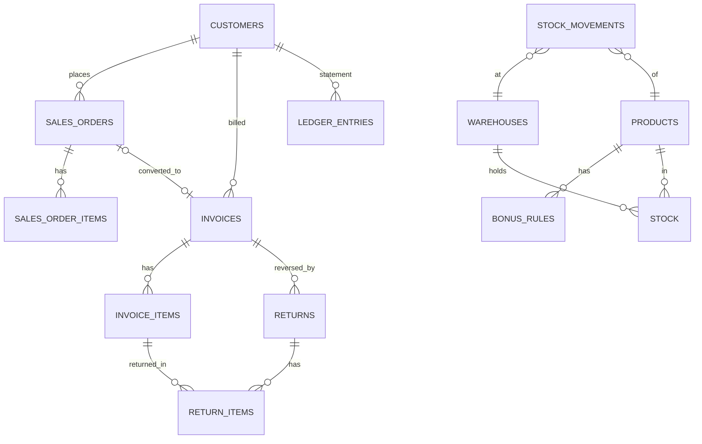
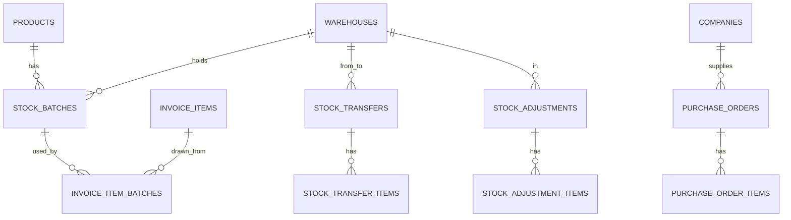
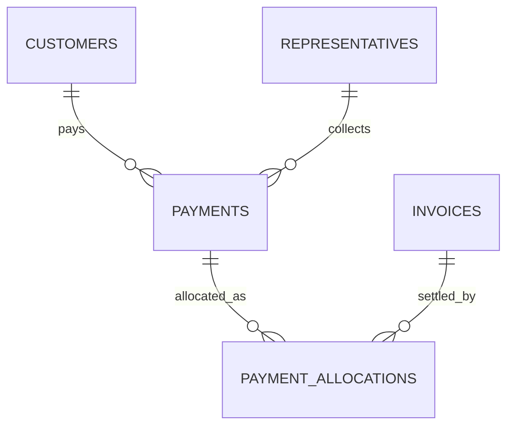
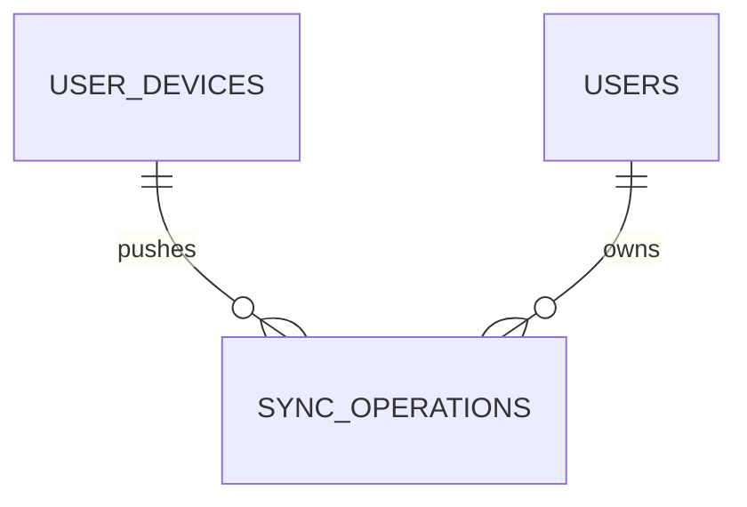
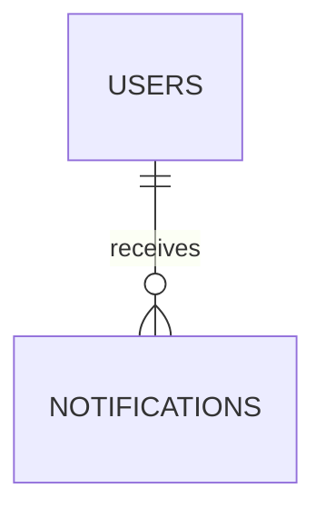

# ERD مبدئي (Mermaid)

## قيود جوهرية
- `CHECK (returned_quantity <= quantity)` و`CHECK (bonus_returned_quantity <= bonus_quantity)`.
- `UNIQUE(idempotency_key)` على Returns/Payments/Orders/Visits القادمة من الموبايل.
- `LedgerEntries` و`AuditLogs` و`StockMovements`: Append-only (منع UPDATE/DELETE عبر صلاحيات DB وtriggers).
- sequences منفصلة: customer / product / order / invoice / payment / return.

## إضافات Phase 4 (Mermaid)

- `invoice_items`: `quantity` (مباع) و`bonus_quantity` (مجاني) منفصلان، و`returned_quantity` و`bonus_returned_quantity` تراكميان، و`bonus_rule_snapshot` لقطة القواعد.
- `return_items.line_type`: `Sold | Bonus | BonusBilled`.
- `ledger_entries`: الرصيد = `customers.opening_balance + Σdebit − Σcredit`.

## إضافات Phase 5 (Mermaid)

- `Stock.quantity = Σ batch.quantity + مخزون بلا تشغيلة`، و`Stock.quantity = Σ الحركات الموقّعة`.
- `stock`: `average_cost` و`last_cost` (متوسط مرجّح لكل مخزن/منتج).

## إضافات Phase 6 (Mermaid)

- `payments.allocated_amount = Σ allocations`، والباقي رصيد على الحساب. `invoices.paid_amount = Σ allocations (للتسديدات المؤكدة)`.

## إضافات Phase 8 (Mermaid)

- `sync_operations(deviceId, localId)` فريد؛ `status`: `Pending | Applied | Conflict | Rejected | Failed | Discarded`؛ الحمولة `payload` تبقى دائماً.

## إضافات Phase 9 (Mermaid)

- `notifications(userId, dedupeKey)` فريد؛ `readAt` للمقروء.
